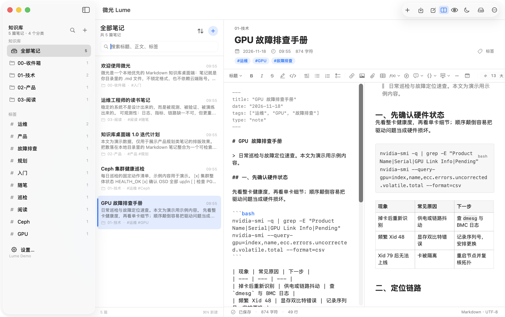
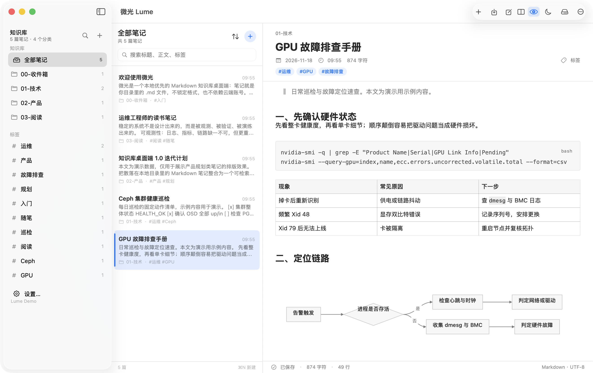
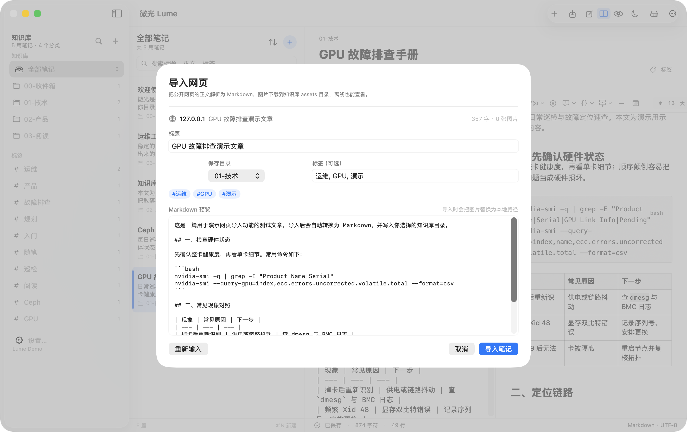
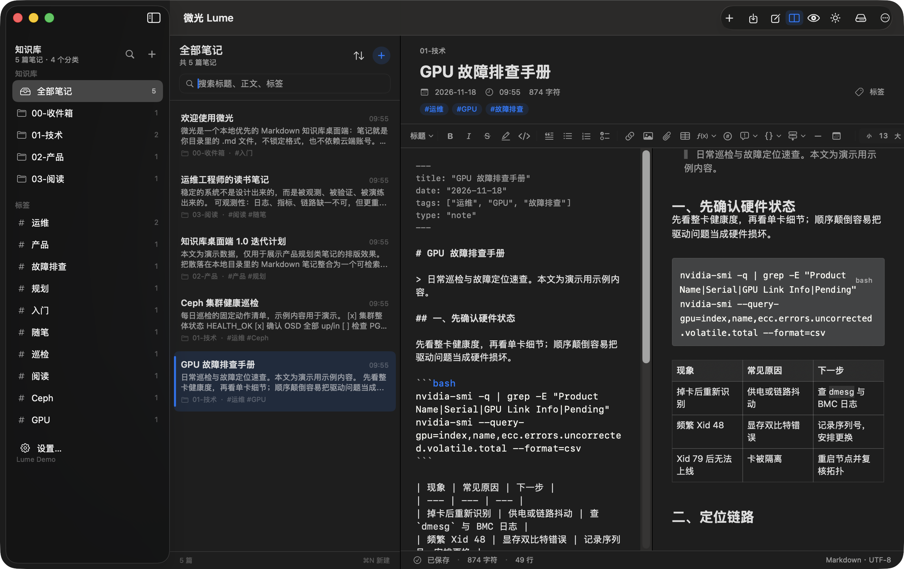

# 微光 Lume

> 本地优先的 macOS Markdown 知识库桌面端 —— 记下思绪里的每一点光亮。
>
> A local-first Markdown knowledge base for macOS.

微光直接读取你目录里的 `.md` 文件，不引入私有数据库，也不要求登录账号。它提供原生 macOS 的三栏浏览、实时预览、完整 Markdown 渲染、iCloud 同步，以及把网页保存为可离线阅读的本地笔记。

> 本文截图使用独立的演示知识库与测试数据，不包含任何个人目录或真实笔记。









## 功能

### 知识库

- 目录即知识库：扫描 `.md` 文件，识别 YAML frontmatter（标题、日期、标签）
- 三栏布局：目录与标签、笔记列表、编辑与预览
- 标题、正文、标签的本地搜索，结果按相关度排序
- 新建、重命名、复制、移动、删除；删除进入系统废纸篓，可恢复
- 文件监听 + 自动保存；检测到外部修改时提示冲突，不静默覆盖

### 编辑与阅读

- 仅编辑、分栏、仅预览三种模式，可切换单栏即时排版
- 深浅色主题，可跟随系统；支持选择系统字体，编辑区与预览分别设置字号
- 预览支持阅读字号与内容宽度（窄 / 标准 / 宽 / 全宽），标题字号随阅读字号等比缩放
- 快捷键可在设置中逐项录制、清除与恢复默认，组合冲突会自动让位给新命令
- 预览图片自适应宽度，独占一段时居中显示并带题注，点击放大查看
- 超长链接在分隔符处自动换行，不再溢出正文区域
- 代码块带语言标识、行号与悬停复制按钮
- 任务清单可直接在预览中勾选并回写源文件
- 导出为 PDF

### Markdown 渲染

- 基于 swift-markdown（cmark-gfm）的 GFM 解析：表格、任务清单、删除线、自动链接
- 代码语法高亮，支持常见语言
- Mermaid 流程图原生渲染（不依赖 mermaid.js）
- LaTeX 子集公式：行内与块级
- GitHub Alerts、脚注、定义列表
- MarkText 风格的行内扩展：高亮、上标/下标、emoji 短代码、行内 HTML

### 网页导入

- 输入网页地址，自动提取标题、正文与关键词，转换为 Markdown
- 微信公众号与 CSDN 文章支持；普通抓取失败时以内置 WebKit 渲染兜底
- 图片并发下载到知识库 `assets/web/` 目录，正文改写为相对路径，离线可看
- 导入前选择保存目录、编辑标签，并预览 Markdown 结果
- 自动去除导航、广告位与模板装饰；公众号开头的名片导流、文末的资料包、二维码和往期推荐整段截断，相关图片不会下载

### 数据与同步

- 笔记与附件始终保存在本地目录
- 可将知识库复制到 iCloud Drive，在多台 Mac 间同步
- 无账号体系、无遥测、无广告 SDK

## 技术栈

- Swift / SwiftUI / AppKit，最低 macOS 14
- SwiftPM 构建，`Lume` 可执行目标
- TextKit 2 编辑器，swift-markdown AST 渲染管线
- WebKit 用于网页兜底抓取，URLSession 下载图片

## 开源组件与许可证

本项目使用或参考了以下开源项目，完整版权声明与许可证全文见 [THIRD_PARTY_NOTICES.md](THIRD_PARTY_NOTICES.md)。

| 组件 | 用途 | 许可证 |
| --- | --- | --- |
| [SwiftSoup](https://github.com/scinfu/SwiftSoup) | HTML 解析与网页正文提取 | MIT |
| [swift-markdown](https://github.com/swiftlang/swift-markdown) | Markdown AST 解析 | Apache-2.0（附 Runtime Library Exception） |
| [swift-cmark](https://github.com/swiftlang/swift-cmark) | CommonMark/GFM 解析内核 | BSD-2-Clause |
| [swift-highlight](https://github.com/atacan/swift-highlight) | 代码块语法高亮 | BSD-3-Clause |
| [MarkText](https://github.com/marktext/marktext) | emoji 短代码数据与部分渲染规则参考 | MIT |
| [MiaoYan](https://github.com/Tw93/MiaoYan) | 交互与视觉设计参考（未包含源代码） | MIT |

说明：

- 未内置 mermaid.js、KaTeX、MathJax 等运行时；图表与公式为项目自身的原生实现
- 界面图标使用 Apple SF Symbols，须遵守 Apple 的许可条款
- 应用图标与示例配图由本项目生成

## 下载

在 [Releases](https://github.com/borays/lume/releases) 下载 `Lume-<版本>.dmg` 或源码 zip。

- DMG 由 GitHub Actions 在 Apple Silicon 运行器上构建，适用于 Apple Silicon Mac（macOS 14+）
- 应用为 ad-hoc 签名，首次打开如被 Gatekeeper 拦截，请右键选择「打开」

## 构建与运行

环境要求：macOS 14+，Xcode Command Line Tools（Swift 5.9+）。

```bash
cd lume
swift build                 # 调试构建
./build-app.sh              # 打包为 lume/dist/Lume.app
```

自测（离线检查渲染、搜索、网页解析等）：

```bash
.build/debug/Lume --selftest
```

当前应用为 ad-hoc 签名，首次打开如被 Gatekeeper 拦截，请右键选择「打开」。

## 目录结构

```text
lume/
├── Package.swift            # SwiftPM 配置与依赖
├── Info.plist               # 应用元信息
├── build-app.sh             # 生成 .app 包
├── Sources/Lume/
│   ├── App/                 # 入口、菜单命令、主题
│   ├── Core/                # 扫描、索引、存储、文件监听、自测
│   ├── Import/              # 网页抓取与 HTML→Markdown
│   ├── Models/              # 笔记与目录模型
│   ├── Render/              # Markdown / 代码 / 公式 / 图表渲染
│   ├── Support/             # 图片、通知、PDF 导出
│   └── Views/               # 主界面、编辑器、预览、弹窗
└── Tools/                   # 图标生成脚本
```

## 已知限制

- 需要登录或人机验证的网页可能无法抓取
- 公众号与博客模板版式差异较大，未覆盖的推广形式可能残留，需要手动整理
- Mermaid 支持常用流程图语法，复杂图表可能降级为代码块
- LaTeX 公式支持常用子集，不保证与 KaTeX 完全一致

## 项目状态

1.0.6 已发布。欢迎通过 Issue 反馈问题或建议。

## 许可证

本仓库尚未声明开源许可证。在添加 `LICENSE` 之前，默认保留所有权利；公开分发前请先确定许可证。
